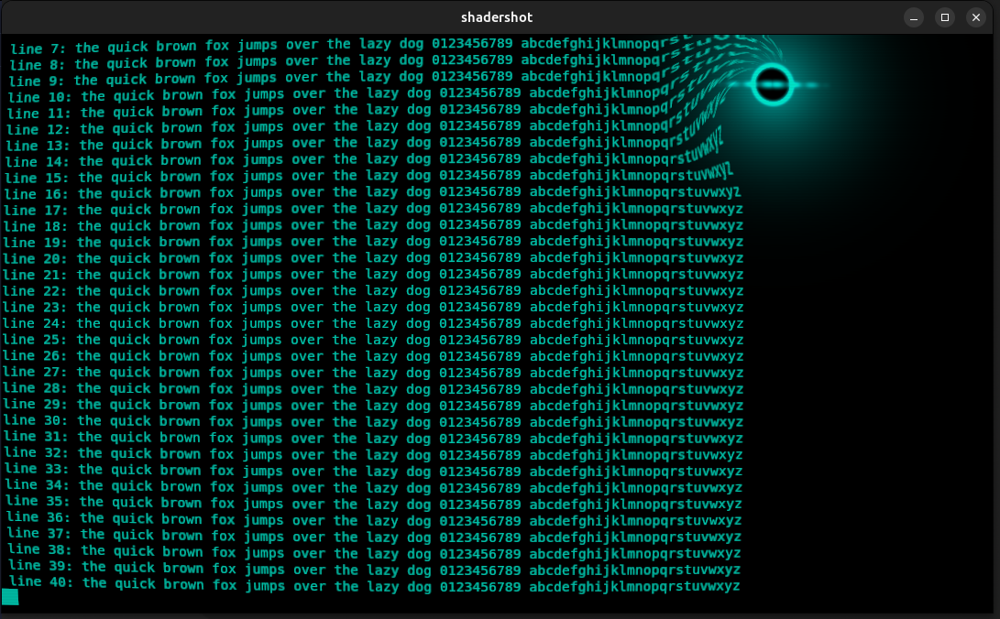

# kitty-black-hole

A custom shader for the [kitty terminal](https://sw.kovidgoyal.net/kitty/).
A black hole drifts along the top of the window. Text near it is pulled in,
twisted and swallowed. The pipeline also applies the CRT effect with the blue
tint that ships with kitty (`crt-blue`).



## Requirements

- kitty 0.49.0 or later (custom shaders were added in 0.49.0).
- The `crt` shader that ships with kitty. It is not copied into this repository.
- The CRT shader does not work with `background_opacity` below 1.

## Install

Copy the two files in `shaders/` to the `shaders` directory in your kitty
configuration directory, and select the pipeline in `kitty.conf`.

```bash
mkdir -p ~/.config/kitty/shaders
cp shaders/black-hole.slang shaders/black-hole-crt.pipeline ~/.config/kitty/shaders/
echo 'custom_shaders black-hole-crt' >> ~/.config/kitty/kitty.conf
```

Open a new kitty window, or press `ctrl+shift+f5` to reload the configuration.

To use the black hole without the CRT effect, remove the second group from
`black-hole-crt.pipeline`.

## Files

| File | Purpose |
| --- | --- |
| `shaders/black-hole.slang` | The black hole shader. |
| `shaders/black-hole-crt.pipeline` | Runs `black-hole`, then the shipped `crt` shader with the `crt-blue` tint. |

## Settings

The constants at the top of `black-hole.slang` control the effect:

| Constant | Meaning |
| --- | --- |
| `HOLE_RADIUS` | Radius of the event horizon, as a fraction of window height. |
| `INFLUENCE` | Distance from the hole over which text is affected. |
| `PULL` | How strongly text is dragged in. Keep at or below 0.5. |
| `SWIRL` | Twist of the text near the hole, in radians. |
| `ROAM` | How far the hole drifts sideways from the centre. |
| `TOP_MARGIN` | Distance of the hole from the top edge. |
| `GLOW` | Colour of the accretion disk (linear RGB). |

The hole crosses the window every 30 seconds. The vertical bob repeats every
6 seconds.

## Limits

- The shader runs on every frame, at about 30 frames per second
  (`animation_step 33` in the pipeline). It uses some GPU all the time.
- Mouse clicks and selection near the hole use the original text positions,
  not the twisted ones. The CRT curve is mapped correctly. The hole is not.

## Licence

MIT. See `LICENSE`.
